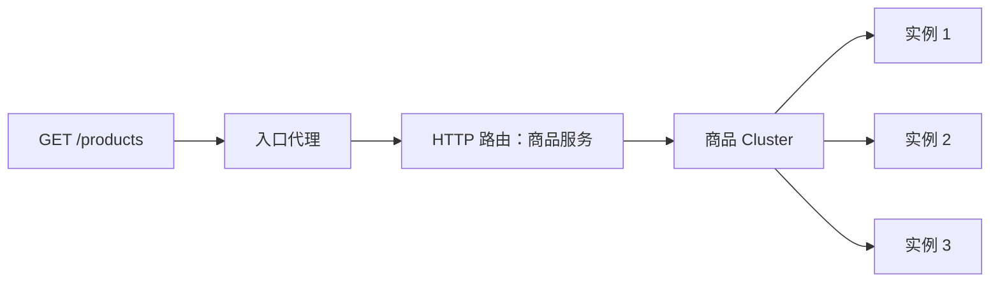

# 02　为什么需要代理和网关

本章目标：知道反向代理在业务链路中的位置，能区分四层与七层转发、路由与负载均衡，并理解为什么代理逐渐需要控制平面。先修：第 01 章的连接与 HTTP 请求。

## 先想象没有代理

你运行一个商城服务，最初只有一台后端，客户端直接访问它。增加第二台后端以后，客户端该选谁？后端重新部署、IP 改变怎么办？每个后端都要分别配置证书、访问日志和限流吗？如果客户端来自互联网，你通常不希望把内部所有地址和认证方式交给每个调用者。

把一层反向代理放在入口可以集中解决这些问题。客户端只知道稳定入口；代理根据请求选择服务，再选择具体实例，建立到后端的连接，并把响应带回客户端。它会成为新的网络跳点，也会占用 CPU、内存和连接数，因此需要监控、容量规划和高可用。便利来自集中能力，责任也随之集中。

“正向”和“反向”描述的是服务关系。正向代理通常代表客户端访问外部目标；反向代理通常代表一组服务接收外部请求。它们都可以连接另一端，却服务于不同的配置和信任模型。Envoy 能用于多种拓扑，本书主要讲反向代理与应用网关。

## 路由先决定去哪类服务

设商城有商品服务和订单服务。`/products` 应去商品服务，`/orders` 应去订单服务。这是路由。商品服务有三个实例，选其中一个来处理当前请求是负载均衡。前者解决“哪一组”，后者解决“组里哪一个”。如果把这两个选择混在一起，阅读 Envoy 的 Route 和 Cluster 时就会迷路。

七层代理能解析 HTTP 方法、Host、路径和头部，所以能按 `Host: shop.example.com`、路径前缀 `/products` 做决定。四层代理主要基于连接层信息转发字节，不一定理解 URL。TLS 加密以后，在没有终止 TLS 的情况下，代理通常看不到 HTTP 路径；TLS 透传和 HTTP 路由不能随意同时假设存在。

图中选择实例的算法可以是轮询，也可以考虑最少请求、权重等因素。但算法不保证业务处理耗时一致。一次“半数流量”配置也不意味着连续十个请求必然正好五五开；权重表达的是选择倾向，实际还受采样量、连接和协议影响。

## 为什么还有过滤器

转发前后经常需要处理公共能力：产生请求标识、验证身份、检查限流、修改头部、记录结果。Envoy 用不同层次的过滤器组合这些工作。HTTP connection manager（HCM）是把下游连接转换为 HTTP 流处理的关键网络过滤器；它内部再运行 HTTP 过滤器链。最后的 router HTTP 过滤器执行向上游的路由转发。

过滤器顺序会影响结果。例如认证失败后直接返回 401，请求就没有机会到达后端；本地响应也可以被记录在代理访问日志中。因此“后端没有日志”不表示请求从未到过入口，它可能被入口的策略终止。后面排障时会检查 Envoy 的响应标记和路由，而不是只查业务日志。

## 下游与上游是相对方向

对一台 Envoy 而言，发来请求的一侧叫 downstream，Envoy 要连接的一侧叫 upstream。入口场景通常是“浏览器在下游，业务在上游”。如果业务再请求另一个 Envoy，同一个业务进程可能在另一段链路里成为下游。不要把 upstream 永久等同于互联网，也不要把 downstream 永久等同于内部服务。

代理通常维护独立的两段连接。客户端连接到代理成功，并不说明代理连接后端成功。这解释了为什么客户端能收到代理生成的 503：第一段连接健康，第二段可能没有可用端点或建连失败。TLS 也分为下游 TLS 和上游 TLS；给入口配置证书，不会自动加密代理到后端的连接。

## 网关增加了管理边界

“网关”通常包含一组面向访问边界的能力和管理方式：团队共享入口、路由授权、证书与安全策略、资源状态等。它不是一个标准的单一进程类型。Envoy Proxy 可以承担数据平面网关角色，Envoy Gateway 则进一步提供配置与生命周期管理。在 Kubernetes 中，Gateway API 把平台团队管理入口、应用团队声明路由的职责显式表达出来。

先把这一层次关系记牢：网络代理是执行者，配置系统决定执行规则，平台 API 表达管理意图。一个功能可能跨越三层，例如“应用声明一个 HTTPS 路由”，最终需要 API 授权、控制平面翻译、数据平面证书和监听器全部配合。

## 练习与参考答案

1. `/orders` 转发到订单服务、订单服务有三台实例，这两个选择分别叫什么？
2. 代理终止下游 TLS，是否表示上游必然也是 TLS？
3. 请求返回 401，后端没有日志，是否一定是网络没通？

参考答案

1. 路由选择服务，负载均衡从该服务的实例里选择上游端点。
2. 否。两段连接独立配置，应分别检查入口证书与后端传输安全。
3. 否。认证过滤器可能直接返回本地响应，需要结合入口日志和策略排查。

继续：[三个项目](03-three-projects.md)。来源：[Envoy v1.36 架构说明](https://www.envoyproxy.io/docs/envoy/v1.36.0/intro/arch_overview/intro/arch_overview)、[HCM](https://www.envoyproxy.io/docs/envoy/v1.36.0/intro/arch_overview/http/http_connection_management)、[Envoy Gateway 项目目标](https://github.com/envoyproxy/gateway/blob/v1.9.2/GOALS.md)。
