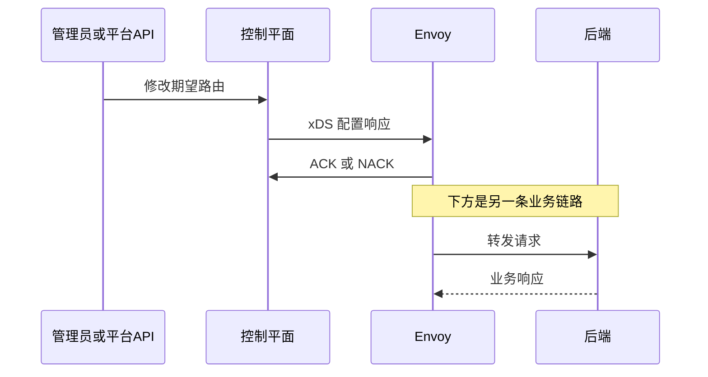

# 03　分清三个项目与两条数据流

本章目标：能把 Envoy Proxy、go-control-plane、Envoy Gateway 放到正确位置，选择适合自己的学习与使用路径。先修：代理、上游、下游的含义。

## 三个名字回答三个问题

Envoy Proxy 回答“谁接收并转发请求”。它是主要用 C++ 实现的代理进程，读取配置，打开监听端口，维护上游连接，执行路由和过滤器。即使不运行任何控制平面，也能用一份静态配置启动它。本书实验一就是这样。

go-control-plane 回答“Go 程序怎样向 Envoy 提供动态配置”。它包含 xDS gRPC 服务端实现、缓存接口和相关工具；仓库中的 Envoy API 子模块提供生成的 Go 消息类型。它没有替你实现商城路由、租户权限、数据库或完整的产品界面。你的程序需要把自己的业务模型转换为 Listener、Route、Cluster 等资源，再发布给缓存和服务端。

Envoy Gateway（简称 EG）回答“怎样从平台资源管理网关”。它理解 Gateway API 和 EG 扩展 API，验证引用和策略，产生内部表示、xDS 配置以及数据平面基础设施。Kubernetes 路径里，你通常提交 Gateway、HTTPRoute 等对象，然后由 EG 管理相关 Envoy 代理。它让应用开发者不必为每条路由直接编写 Go protobuf 结构。

| 组件 | 主要输入 | 主要输出 | 本书学习重点 |
| --- | --- | --- | --- |
| Envoy Proxy | 启动配置与 xDS 资源 | 业务转发、日志、指标 | 配置为什么影响请求 |
| go-control-plane 库 | 你构造的资源与缓存更新 | xDS 响应 | 如何构造和分发配置 |
| Envoy Gateway | Gateway API、策略、后端信息 | xDS、基础设施、资源状态 | 意图如何翻译并落地 |

这些组件不是互斥的“网关产品排行榜”。它们位于不同层级。一份 EG 源码会涉及 xDS、Envoy API 类型以及 Kubernetes 客户端；阅读到相同术语并不表示它们承担相同责任。

## 业务流和配置流

假设客户端访问商品详情。业务请求走“客户端 → Envoy → 商品后端”。控制平面通常不在每个业务请求的转发路径上。与此同时，Envoy 通过长连接从控制平面订阅配置；应用团队修改路由后，控制平面生成新资源，再通知 Envoy。这是配置流。

图中 ACK 说明某次协议更新得到确认，它不等于业务验证全部通过。例如资源语法可接受，但上游端口写错，业务仍可能返回 503。反过来，控制平面短暂离线，也不一定立刻导致已有流量中断：Envoy 通常继续使用已经接受的配置。不过新节点、配置初次就绪、资源 TTL、重连和证书轮换等条件仍可能影响可用性，不能把“保留旧配置”当作完整高可用方案。

## 为什么先学库再学平台

你可以直接从 EG 快速开始，但一旦遇到路由未生效，单看 Kubernetes YAML 很难知道中间发生了什么。本书先用小型 Go 程序把资源图发布给 Envoy，目的是让你看见配置流的每一站。随后再看 EG，你能把 HTTPRoute 映射回 Route，把 Service/EndpointSlice 映射回 Cluster 和端点，并理解 status 为什么要分别报告接受与引用解析情况。

如果你的工作只是使用网关，可在第 07 章后先读第三篇，遇到 xDS 细节时回到第二篇。若你要开发自己的配置系统，第二篇是重点，第三篇则展示一个真实项目如何实现资源翻译、状态与基础设施协调。两种路径都应做第 24 章的排障练习。

## 固定版本是阅读坐标

本书使用 go-control-plane 根模块 v0.14.0 与 EG v1.9.2。它们来自不同发布序列，不能用大小比较新旧。go-control-plane 仓库还包含独立的 `envoy`、`ratelimit` 等 Go 模块；GitHub 的 latest release 可能是 `envoy/v1.40.0`，这不表示根模块升级成了 v1.40.0。

根模块 v0.14.0 的 go.mod 声明 Envoy API 子模块 v1.36.0。仓库开发用的相对路径 replace 是上游工作区安排，不应直接复制进自己的项目。EG v1.9.2 有自己的依赖与兼容矩阵。本书实验二与实验三因此各自固定镜像，不能把实验二的 Envoy 镜像手动替换进 EG 部署并假定受支持。具体版本与 commit 见[附录](../appendices/versions.md)。

## 练习与参考答案

1. 删除控制平面进程后，业务请求是否必然立即失败？
2. 用 go-control-plane 是否自然就拥有 Gateway API 控制器？
3. GitHub latest release 名为 envoy/v1.40.0，应该怎样核对根模块版本？

参考答案

1. 不必然。已有可用配置通常仍留在 Envoy，但初次配置、新实例和后续变化会受影响。应分别观察配置连接与业务链路。
2. 否。它提供通用服务端与缓存基础设施；平台 API、翻译和权限等需要另行实现，EG 提供了这类更完整的能力。
3. 查根模块的 `v0.*` tag、go.mod 与模块路径，并区分 `envoy/v*` 子模块 tag。

继续：[资源图](04-resource-graph.md)。来源：[go-control-plane 范围说明](https://github.com/envoyproxy/go-control-plane/blob/v0.14.0/README.md)、[根模块依赖](https://github.com/envoyproxy/go-control-plane/blob/v0.14.0/go.mod)、[EG README](https://github.com/envoyproxy/gateway/blob/v1.9.2/README.md)。
