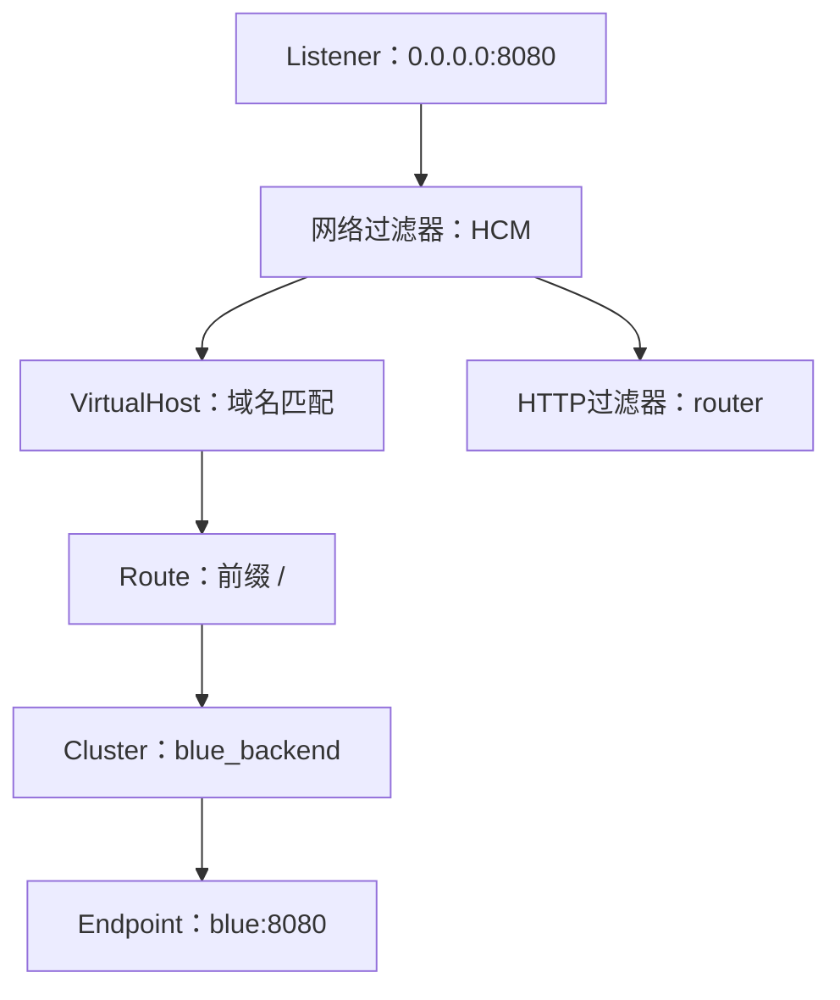

# 04　把 Envoy 配置看成资源关系图

本章目标：能沿 Listener → HCM → Route → Cluster → Endpoint 追踪一个请求，理解为什么“配置有字段”还不等于“资源关系正确”。先修：HTTP 路由与负载均衡。

## 按请求走一遍

想让 Envoy 在容器内 8080 端口接收 HTTP，把请求转给 `blue:8080`。先要有 Listener，它告诉 Envoy 监听哪个地址与端口。Listener 还需要选择 filter chain：连接该如何被处理，例如按 TLS 情况选择不同链。在我们最简单的例子里只有一条链，里面运行 HTTP connection manager，简称 HCM。

HCM 解析 HTTP，把请求交给一串 HTTP 过滤器，并关联路由配置。路由配置里可以有多个 VirtualHost，每个虚拟主机通过域名匹配请求的 Host/authority。命中虚拟主机后，再按路由规则匹配路径、方法或头部。一个简单 route action 指向名为 `blue_backend` 的 Cluster。

Cluster 描述一组上游连接目标以及如何连接和选择它们，例如连接超时、发现方式和负载均衡策略。具体端点还需要地址和端口，例如 `blue:8080` 或 `10.0.0.7:8080`。Envoy 连接到端点以后，才把 HTTP 请求交给业务服务。



图表示概念依赖，并非每个箭头都对应单独的网络请求。VirtualHost 和 Route 通常嵌在 RouteConfiguration 中；Endpoint 通常位于 ClusterLoadAssignment 中。HTTP router 过滤器使用路由结果完成上游转发，它不是另一个外部网关。

## 名字连接资源

Listener 的 `name` 与监听端口不是同一个东西。Cluster 的名字也不是 DNS 名。例如 `blue_backend` 可以是任意稳定的资源名；真正用于连接的主机是端点里的 `blue`。路由 action 引用 `blue_backend` 时必须与 Cluster.name 对上。拼写差一个字符，YAML 依然可能解析成功，运行时却找不到目标。

动态配置进一步引入资源发现关系：LDS 提供 Listener，RDS 提供 RouteConfiguration，CDS 提供 Cluster，EDS 提供 ClusterLoadAssignment。SDS 提供证书和密钥相关 Secret。这里的 DS 是 Discovery Service；开头字母是具体资源类别。不是每个项目都要用齐全部服务：静态 Listener 可以内嵌路由，DNS Cluster 可以不通过 EDS 获得端点。

```text
LDS Listener "book_listener"
  └─ HCM.rds.route_config_name = "book_routes"
       └─ RDS RouteConfiguration "book_routes"
            └─ route.cluster = "blue_backend"
                 └─ CDS Cluster "blue_backend"
                      └─ eds_config / service_name
                           └─ EDS ClusterLoadAssignment
```

EDS 的资源名由 Cluster 的 EDS 配置决定；没设置 service_name 时通常使用 Cluster.name。不要把“默认同名”误当成协议永远要求每种名字相等。实验使用同名来减少新手负担，但源码篇会解释真实字段。

## 三种发现方式先建立区别

STATIC 把端点写在配置里；STRICT_DNS 定期解析配置中的 DNS 名，把解析结果作为上游主机集合；EDS 从 xDS 资源获得端点。STATIC 名字容易令人误会：本书静态启动配置中也可以使用 STRICT_DNS Cluster，因为“静态文件”描述资源的配置来源，而 STRICT_DNS 描述 Cluster 怎样发现后端地址。

实验一使用 Compose 服务名，因此选择 STRICT_DNS。把容器名当作一个永远不变的 IP，硬编码进 STATIC 端点通常很脆弱。实验二则用 EDS 表达端点，并通过 Go 更新 RDS 在蓝绿 Cluster 中切换。你会同时看到“有两个可用服务”和“当前路由选其中一个”是两个独立事实。

## 配置被接受也需要等待依赖

动态资源可能不是同一瞬间到达。Listener 引用了还没有加载的路由，或者 Cluster 等待 EDS，都会出现初始化或 warming 状态。理解资源图后，可以问：这个资源缺的是哪条边，而不是只问“Envoy 为什么没启动”。不同资源类型有各自的更新生命周期；把四组资源放进一个 snapshot 不等于整个代理在一个全局事务中瞬间切换。

这也解释了后面的验证顺序：语法与字段验证、引用关系检查、Envoy 接受情况、运行状态、真实请求，都应各自有证据。`Consistent()` 只检查部分关系，并不会替你验证后端可达、路由到 Cluster 的每条语义或所有扩展配置。

## 练习与参考答案

1. Cluster.name 是 `blue_backend`，DNS 主机是 `blue`，路由应该引用谁？
2. 为什么静态 YAML 中使用 STRICT_DNS 不矛盾？
3. Listener 存在但请求没有走到后端，你会沿哪条图检查？

<details><summary>参考答案</summary>

1. 路由引用 `blue_backend`；Cluster 再用端点 `blue` 发现地址。
2. 前者说配置如何提供，后者说后端地址如何发现，是不同维度。
3. 检查监听与协议、filter chain/HCM、虚拟主机域名、路由匹配、Cluster 名称与状态、端点和连接；动态场景再确认相关资源是否就绪。

</details>

继续：[静态配置](05-static-config.md)。来源：[Envoy v1.36 配置概览](https://www.envoyproxy.io/docs/envoy/v1.36.0/configuration/overview/overview)、[Cluster 发现](https://www.envoyproxy.io/docs/envoy/v1.36.0/intro/arch_overview/upstream/service_discovery)、[本书资源构造](../../labs/02-xds/README.md)。
