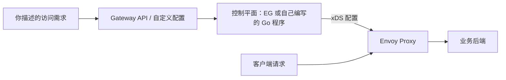

# 从零读懂 Envoy

## 写给第一次接触 Envoy 的你

你可能见过“云原生网关”“服务网格”“xDS 控制平面”这些词，却还不知道它们如何与一次普通的 HTTP 请求连在一起。我们就从这条线开始：浏览器发来一个请求，Envoy 为什么监听某个端口，为什么把请求交给某台后端，后端地址改变后谁通知 Envoy，以及如何用 Kubernetes 的声明式资源管理这一切。

两份仓库解决的是相邻层次的问题。go-control-plane 给 Go 开发者提供 xDS 服务端和配置缓存的基础设施；你仍需编写“业务意图如何变成 Envoy 资源”的逻辑。Envoy Gateway 是更完整的网关控制平面，接收 Gateway API 等资源，生成配置并管理数据平面。Envoy Proxy 才是直接接收并转发业务请求的进程。学完本书，你应能说明三者关系、跑通三个实验、跟踪一条配置变更、判断一个故障发生在哪一层。

## 怎么读

第一次请按 01–07、08–13、16–21 的顺序阅读；14–15、22–23 是深入源码和工程化的第二遍阅读材料。遇到陌生词可以查[术语表](appendices/glossary.md)。每章练习都有参考答案，建议先口述或画图，再展开答案核对。能讲出为什么比复制命令更重要。

准备一个终端、文本编辑器和浏览器即可。实验一需要 Docker Compose；实验二还提供本机 Go 测试路径；实验三需要 Docker、kind、kubectl、Helm。每个实验都在独立目录，有完整文件和清理说明，先阅读 README 再执行。所有监听到宿主机的实验管理端口只用于本机学习。

图中有两条不同的线路：配置流决定 Envoy 怎么工作，业务流经过 Envoy 到后端。后面每一章都能放回这张图里理解。

## 第一篇：从请求到一台 Envoy

1. [一次请求经过了什么](01-foundations/01-one-request.md)
2. [为什么需要代理和网关](01-foundations/02-proxy-and-gateway.md)
3. [分清三个项目与两条数据流](01-foundations/03-three-projects.md)
4. [把 Envoy 配置看成资源关系图](01-foundations/04-resource-graph.md)
5. [逐段读懂第一份静态配置](01-foundations/05-static-config.md)
6. [运行、观察与修改静态代理](01-foundations/06-first-lab.md)
7. [从配置文件走向控制平面](01-foundations/07-control-plane.md)

## 第二篇：用 Go 理解 xDS 控制平面

8. [xDS 协议、版本与确认](02-go-control-plane/08-xds-protocol.md)
9. [够用的 Go、Protobuf 与 Any](02-go-control-plane/09-go-and-protobuf.md)
10. [用 Go 构造资源关系图](02-go-control-plane/10-resource-model.md)
11. [SnapshotCache、分组与一致性](02-go-control-plane/11-snapshot-cache.md)
12. [启动一个 gRPC xDS 服务端](02-go-control-plane/12-grpc-server.md)
13. [动态更新与蓝绿切换](02-go-control-plane/13-dynamic-updates.md)
14. [go-control-plane 源码导读](02-go-control-plane/14-source-tour.md)
15. [从教学服务到生产控制平面](02-go-control-plane/15-production-boundaries.md)

## 第三篇：从 Kubernetes 需求到 Envoy Gateway

16. [够用的 Kubernetes 基础](03-envoy-gateway/16-kubernetes-basics.md)
17. [Gateway API 的角色与授权](03-envoy-gateway/17-gateway-api.md)
18. [部署第一条 Gateway 路由](03-envoy-gateway/18-first-gateway.md)
19. [匹配、转发与策略](03-envoy-gateway/19-routing-and-policies.md)
20. [TLS 与安全边界](03-envoy-gateway/20-tls-and-security.md)
21. [状态、日志、指标与追踪](03-envoy-gateway/21-observability.md)
22. [Envoy Gateway 源码导读](03-envoy-gateway/22-source-tour.md)
23. [扩展、升级与运维](03-envoy-gateway/23-extensions-and-operations.md)

## 第四篇：把知识连起来

24. [用证据分层排障](04-practice/24-troubleshooting.md)
25. [综合项目：一套可解释的蓝绿网关](04-practice/25-capstone.md)
26. [四周学习计划与自测答案](04-practice/26-learning-plan.md)

## 附录

- [中英术语与常见混淆](appendices/glossary.md)
- [按问题查源码](appendices/source-index.md)
- [固定版本、兼容矩阵与资料来源](appendices/versions.md)
- [命令、端口与实验速查](appendices/lab-reference.md)

本书是可独立阅读的讲解，不是两个仓库的文件逐一翻译。源码引用用于解释关键机制；完整 API 字段和功能支持范围，请继续沿每章的固定版本来源阅读。
